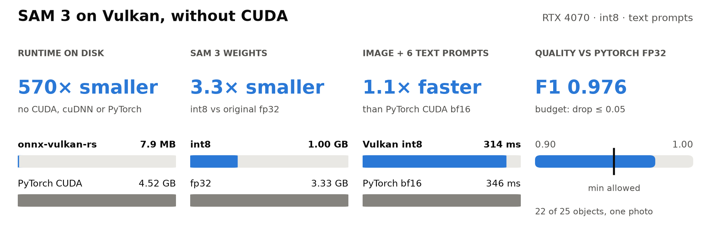

# Benchmark results and methodology

[Back to the project](README.md)

The overview chart uses the values below. Each pair has its own linear scale;
bar lengths cannot be compared across models. Piper cards use sentence 1 only;
the second sentence and FP32 intermediate are recorded below. SAM 3 uses the
original PyTorch CUDA bf16 application as its latency reference; other cards
use ONNX Runtime CPU. Timings are historical inference measurements, not a
fresh benchmark of the current checkout.

The chart data is in [model-benchmarks.json](assets/model-benchmarks.json).
Regenerate both themes with:

```bash
uv run --with matplotlib scripts/render-model-benchmarks.py
```

## Application comparisons

The results below cover image segmentation, speech synthesis, speech
recognition, detection, classification and language models. Each comparison
names its reference: the original PyTorch application, the original ONNX
model on CPU, or the same graph on a different backend. Measurements come from
separate campaigns on an RTX 4070; they are not a fresh benchmark of the
current checkout.

### SAM 3 without CUDA

<picture>
  <source media="(prefers-color-scheme: dark)" srcset="assets/sam3-benchmark-dark.png">
  <source media="(prefers-color-scheme: light)" srcset="assets/sam3-benchmark-light.png">
  
</picture>

Meta's SAM 3 (a text prompt in, a mask for every matching object out) runs end
to end on Vulkan from Rust. On an RTX 4070 the int8 chain is faster than
PyTorch CUDA bf16 on the same photo: 161 vs 189 ms for the first prompt, 314
vs 346 ms for an image with six prompts.

- **Article:** [Segment Anything 3 Without CUDA: a 7.9 MB Engine, 1 GB of int8 Weights, and What Quantization Cost](https://autognosi.substack.com/p/segment-anything-3-without-cuda-a)
- **Model:** five int8 graphs (text, clicks, boxes) with one script per prompt
  type on [Hugging Face](https://huggingface.co/Autognosi/sam3-onnx-vulkan).
  The scripts use plain ONNX Runtime, CPU by default:
  `python segment.py photo.jpg "plastic bottle" --out overlay.png`.
- **What the numbers do not cover:** one GPU (NVIDIA only so far); f16
  attention is opt-in (`ONNX_VULKAN_ATTENTION_FP16=1`); the reference is
  PyTorch eager, not TensorRT or `torch.compile`; F1 is against PyTorch fp32
  outputs on one photo (0.922 on a wider 16-pair set, measured before the
  latest kernels), not ground truth.

### Piper TTS: Serena and Ryan

Both voices run with CPU fallback disabled through the Vulkan plugin and the
standalone Rust engine. Optimized FP32 kernels accelerate the original decoder;
selective dynamic INT8 quantizes its 36 residual convolutions while leaving the
encoder, duration predictor and four transposed convolutions in FP32.

The reference below is the **original FP32 voice on ONNX Runtime CPU**, with
all graph optimizations and default threads on a Ryzen 5 7600. Vulkan columns
are inference latency through the compiled EP, excluding loading,
phonemization and WAV encoding. All four cases use noise scales `[0, 1, 0]`
and produce 22,050 Hz mono audio.

| Voice / sentence | Audio duration | Original FP32, CPU | FP32, Vulkan EP | Selective INT8, Vulkan EP |
|---|---:|---:|---:|---:|
| Serena high (Italian), 1 | 6.50 s | ~742 ms | 84.30 ms | **69.05 ms** |
| Serena high (Italian), 2 | 6.43 s | ~729 ms | 82.60 ms | **66.83 ms** |
| Ryan high (US English), 1 | 5.410 s | 911.63 ms | 69.872 ms | **58.411 ms** |
| Ryan high (US English), 2 | 5.433 s | 953.57 ms | 69.721 ms | **57.525 ms** |

| Voice | FP32 ONNX file | Selective INT8 ONNX file | Size reduction | Peak GPU storage, FP32 → INT8 |
|---|---:|---:|---:|---:|
| Serena high | 114.2 MB | **83.7 MB** | 26.7% | 317 → 328 MB |
| Ryan high | 120.8 MB | **89.8 MB** | 25.65% | 283 → 287 MB |

MB means decimal megabytes. Storage counters cover runtime GPU allocations,
not total device VRAM: smaller weights did not lower peak storage here.

**How these were measured.** Serena (2026-10-23) uses six rotating rounds of
11 iterations, first excluded; the final EP medians above include GPU-span
instrumentation. Its CPU reference timed only two iterations and is noisy
(an earlier run gave 696 / 802 ms), so it supports an approximate 700–800 ms
comparison. Ryan (2026-10-24) uses 20 alternating FP32/INT8 blocks per sentence,
40 retained samples per variant. Both campaigns requested GPU-span
instrumentation with per-operator statistics disabled; Ryan's JSON records
span timestamps for standalone, with null EP span records. INT8 lowers
Ryan EP latency by 16.40% / 17.49%, winning all 20 paired rounds per sentence.
Its separately measured CPU reference uses two warmups and 20 retained runs;
it is the ORT default configuration, not a search for the fastest CPU setup.
Both campaigns use ORT 1.29.0 and NVIDIA driver 595.104.02. Serena and Ryan's
absolute times should not be ranked against each other: inputs and protocols
differ.

**Quality is a separate result.** EP and standalone are bit-identical on the
tested inputs, but both FP32 voices miss the unchanged strict CPU tolerance
(`atol=1e-5, rtol=1e-4`). Serena INT8 has waveform SNR 27.6 / 25.8 dB and
log-spectral distance 1.89 / 2.01 dB against original CPU FP32 on two sentences;
no listening study or MOS score was recorded. Ryan INT8 fails its predeclared
SNR ≥20 dB and spectral-distance ≤3 dB thresholds on all three evaluated
sentences (SNR 6.3–9.8 dB; distance 4.0–4.4 dB). An informal comparison of
Ryan's original CPU FP32, CPU INT8, Vulkan FP32 and Vulkan INT8 samples was
judged indistinguishable and acceptable by the user. That listening result
does not change the failed numerical contract. Ryan's optimized CPU reference
also misses the original unoptimized CPU tolerance. These are experimental
model results, not numerically promoted production bundles.

The INT8 files, unchanged Piper configs and reproducible recipes are published
on Hugging Face: [Serena](https://huggingface.co/Autognosi/piper-it_IT-serena-high-int8)
and [Ryan](https://huggingface.co/Autognosi/piper-en_US-ryan-high-int8), with a
[detailed Ryan validation report](https://huggingface.co/Autognosi/piper-en_US-ryan-high-int8/blob/main/validation.md).
Ryan's prepared FP32 file remains local; its published recipe rebuilds it.
INT8 is slower on the tested CPU (~4.46 s for Serena and ~4.00–4.14 s for Ryan
in the recorded CPU runs): use the original FP32 voice for CPU inference.

### Other measured models

The [full CPU versus Vulkan comparison](#performance) below includes all 12
measured model/profile cases: Parakeet, RF-DETR, YOLOv4, YOLOv8n, RoBERTa at
two sequence lengths, ResNet50 QDQ/INT8, MobileNetV2 FP32/INT8, Gemma 3 and
Qwen2.5-VL. Those rows compare the **same ONNX graph and weights** on both
backends; they do not claim that this project quantized every model. They also
retain the two MobileNetV2 cases where Vulkan is slower than CPU.

Additional Piper voices (Cori, Lessac, LJSpeech and LibriTTS) were inspected
structurally, but have no measured Vulkan optimization result here. Shared
decoder shapes alone do not establish their speed or audio quality.

## Performance

This historical matrix predates the Piper campaigns above. It compares the
original test graph on CPU with this project's Vulkan EP using the same
weights and precision, including already-quantized third-party models.

RTX 4070, driver 595.84, Pop!_OS 24.04, batch 1, ORT 1.29.0. Every cell is the
**median of three back-to-back full matrix runs** (`runs/ort129{,-b,-c}`).
Ratio is against the ORT **CPU EP (MLAS)** on the same graph. `GPU` is the
profiler's compute time, i.e. the part of the wall that is actually shaders.

| model | Vulkan EP wall | Original graph, CPU EP | CPU / Vulkan | GPU compute (ms) | blocks | flush | GPU Pareto head |
|---|---|---|---|---|---|---|---|
| parakeet (encoder) | 43.3 ms | 343.8 ms | **7.94×** | 32.8 | 1 | 7 | `MMI_matmul_coop_k32` 59% |
| rfdetr | 40.9 ms | 306.8 ms | **7.50×** | 34.7 | 1 | 9 | `MatMul` 61% |
| yolov4 | 35.5 ms | 176.8 ms | **4.98×** | 19.1 | 1 | 4 | `Conv_split` 54% |
| yolov8n | 7.1 ms | 29.9 ms | **4.21×** | 4.8 | 1 | 2 | `Conv_split` 41% |
| roberta seq 1 | 3.5 ms | 13.3 ms | **3.80×** | 2.2 | 1 | 4 | `GEMV` 46% |
| qwen2.5-VL decoder (int4) | 29.2 ms | 85.4 ms | **2.92×** | 12.7 | 1 | 77 | `MatMulNBits_wide` 37% |
| roberta seq 128 | 19.5 ms | 55.0 ms | **2.82×** | 17.1 | 1 | 4 | `MatMul` 89% |
| resnet50-int8 | 3.3 ms | 6.7 ms | **2.03×** | 2.4 | 1 | 2 | `ConvInteger_coop` 35% |
| resnet50-qdq | 5.1 ms | 9.0 ms | **1.76×** | 3.6 | 1 | 2 | `Conv_split` 62% |
| gemma3-1b (int4) | 16.4 ms | 27.1 ms | **1.65×** | 6.5 | 1 | 57 | `MatMulNBits` 29% |
| mobilenetv2 | 1.7 ms | 1.3 ms | 0.76× | 1.1 | 1 | 2 | `Conv` 21% |
| mobilenetv2-int8 | 1.8 ms | 0.8 ms | 0.44× | 0.9 | 1 | 2 | `Requantize` 30% |

These walls use the default kernels. `onnx-vulkan optimize` measured no further
gain from tuning on YOLOv8n (GPU 5.16 → 4.96 ms, wall 10.97 → 11.94 ms per
process, 2026-10-06) or MobileNetV2, so it keeps the untuned model there.

**These ratios are not comparable with the ORT 1.27.1 table they replace.** Our
walls are 3–8% higher and our GPU compute moved with them (parakeet 30.95 →
32.84 with no kernel touched), i.e. the host is slightly slower today; the CPU
EP reference moved much more, and upward (yolov4 123.4 → 176.8, roberta seq 1
9.4 → 13.3). The improved ratios are ORT's CPU path, not our kernels.

Correctness in the same run: `sync-check.sh` reports **12/12 models clean**
under the Khronos synchronization-validation layer, both int8 classifiers are
bit-exact against their golden data (`max|Δ| = 0.000e0`), and every golden
argmax is reproduced.

Generation, measured on the replayed decode loop rather than on a single
forward: **gemma3-1b 6.24 ms/token (~160 tok/s)** and **qwen2.5-VL 14.09
ms/token (~71 tok/s)**, zero device allocations per step, one flush. These two
were taken on the previous Windows host. Re-measured for gemma3-1b on this host
on 2026-10-06 with the command in
[Decoders with a KV cache](README.md#decoders-with-a-kv-cache): **5.46 ms/token
(~183 tok/s)**, median of the last 16 of 24 steps. qwen2.5-VL has not been
re-measured. The table's gemma and qwen rows are a single forward through the
EP, not this loop.

Read honestly:

- **The biggest single win here was one Vulkan call, not a kernel.** Every
  submit+fence used to create and destroy its fence. `cargo run --release -p
  vk-compute --example flush_cost` times the round trip with nothing to compute:
  0.496 ms through `flush()`, 0.136 ms with a pre-recorded command buffer and a
  reused fence, and 0.494 ms again the moment the fence is created and destroyed
  — so **0.358 ms of every flush was one fence allocation**, which the NVIDIA
  driver charges dearly and lavapipe does not charge at all. Creating the fence
  once and resetting it per submit took **qwen2.5-VL 69.4 → 28.5 ms** and
  **gemma3-1b 41.2 → 17.3**, and moved all twelve models by 0.42–0.73 ms per
  flush — a constant that now shows up identically from 2 flushes to 77.
- **Structure is solved and the submit boundary is now cheap.** Every model is
  at 1 convex block, so boundary *count* was already not a lever; each remaining
  flush costs ~0.14 ms, which is the driver's own floor.
- **The kernels are unchanged across all of this.** GPU compute matches the
  previous Windows-host baseline within ±10% on every model (gemma3-1b 6.4 →
  6.0 ms, rfdetr 34.9 → 34.0, yolov8n 4.83 → 4.86). Everything above and below
  moved the wall around the shaders, never the shaders.
- **Two models are below the CPU EP, and no kernel will move them.**
  `mobilenetv2-int8` spends 0.9 of its 1.8 ms on the GPU; the rest is ORT and
  plugin overhead across 73 nodes. Its `ConvInteger` work is 17 depthwise
  convolutions with `K = 9` — not a GEMM, nothing to tile, nothing to split.
  They are overhead items, and they are labelled as such instead of tuned.
- **The two models that used to be below 1× no longer are**, and neither was
  fixed by a bigger tile. roberta at `seq_len = 1` (0.76×) is a GEMV: 768 useful
  threads on a card that holds 70,656, so the fix was splitting `K` to
  manufacture workgroups — now 3.80×, at 500–515 GB/s against the card's ~504,
  so that lever is spent. resnet50-qdq
  (0.74×) was the same diagnosis with split-K on `Conv` — now 1.76×, against a
  reference so unstable it reads 13.4 / 7.1 / 9.0 ms across three consecutive
  runs.
- **Ratios move because the reference moves, and this table is mostly ratios.**
  Across the three runs behind this table it swung by **1.9×** on the same
  binary (resnet50-qdq 13.4 / 7.1 / 9.0 ms, roberta seq 1 13.4 / 9.9 / 13.3)
  while our own walls repeated to a tenth (yolov8n 7.1 / 7.1 / 7.1) — which is
  why every cell above is a median of three and no single run is quotable for
  the small models. Compare milliseconds, and treat `blocks` / `flushes` /
  `MB transferred`, which are deterministic, as the primary metric.
- **lavapipe numbers mean nothing for performance**; the suite marks those runs
  `perf_valid: false`. They are still a valid *correctness* gate, because
  integer arithmetic is exact on any device.

When `--baseline FILE` is supplied, the regression gate fails on accuracy
outside tolerance, median wall past `perf_tol`, more flushes or MB transferred,
or **more convex blocks / fewer claimed nodes** — the last two are deterministic
and lead the wall clock.

