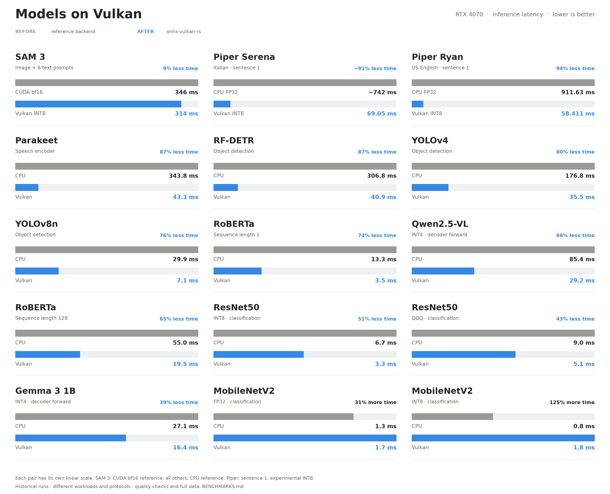

<p align="center">
  <picture>
    <source media="(prefers-color-scheme: dark)" srcset="assets/logo-onnx-vulkan-dark.svg">
    <source media="(prefers-color-scheme: light)" srcset="assets/logo-onnx-vulkan-light.svg">
    
  </picture>
</p>

# onnx-vulkan-rs

A Vulkan Execution Provider **plugin** for ONNX Runtime, entirely in Rust, plus
a **standalone pure-Rust engine** (own ONNX parser, no ORT in the process) that
shares the same kernels. Linux, NVIDIA/AMD GPUs (lavapipe as a CPU
fallback — correctness only, never performance).

## At a glance

<picture>
  <source media="(prefers-color-scheme: dark)" srcset="assets/model-benchmarks-dark.png">
  <source media="(prefers-color-scheme: light)" srcset="assets/model-benchmarks-light.png">
  
</picture>

RTX 4070, recorded runs. SAM 3 compares against PyTorch CUDA bf16; the other
pairs compare against ONNX Runtime CPU. Bars use a separate scale per model.
Piper INT8 is experimental: strict numerical checks fail; listening feedback
for Ryan was positive. [All values, quality checks and methodology](BENCHMARKS.md).

**Models:** [SAM 3](https://huggingface.co/Autognosi/sam3-onnx-vulkan) ·
[Serena](https://huggingface.co/Autognosi/piper-it_IT-serena-high-int8) ·
[Ryan](https://huggingface.co/Autognosi/piper-en_US-ryan-high-int8).
**Article:** [SAM 3 without CUDA](https://autognosi.substack.com/p/segment-anything-3-without-cuda-a).

## Runtime capabilities

Runs int4 LLMs at **~160 tok/s** (gemma3-1b) and **~71 tok/s** (qwen2.5-VL),
puts static int8 convolutions on the **tensor cores**, and reaches 7.94× the
ORT CPU EP on the Parakeet encoder — while refusing at load time, loudly and completely, any
graph it cannot run end to end on the GPU. Reference app: STT with **Parakeet
TDT 0.6B v3 (int8 ONNX)**.

ONNX Runtime has no official Vulkan EP: this project implements one out-of-tree
using the [Plugin EP API](https://onnxruntime.ai/docs/execution-providers/plugin-ep-libraries/usage.html)
(available since ORT 1.23; this repository pins and tests **1.29.0**). The long-term target is the standalone
library; the plugin is how the kernels get validated against a real
runtime on real models.

## Quickstart: your ONNX model on the GPU

Prerequisites, each with a check:

| need | check | if missing (Ubuntu/Pop!_OS) |
|---|---|---|
| Vulkan driver and loader | `vulkaninfo --summary` lists your GPU | `sudo apt install libvulkan1 vulkan-tools` plus the GPU vendor's driver |
| Rust ≥ 1.85 | `cargo --version` | [rustup.rs](https://rustup.rs) |
| clang (bindgen) | `clang --version` | `sudo apt install clang` |
| [uv](https://docs.astral.sh/uv/) | `uv --version` | `curl -LsSf https://astral.sh/uv/install.sh \| sh` |

There is no `doctor` command: a missing piece fails at the step that needs it,
with its name (`cargo build` without clang, `prepare` without ONNX Runtime,
`run` without a Vulkan device).

The `onnx-vulkan` command checks a model, runs it on the GPU against the CPU,
and tunes it; it never claims a speedup it has not measured.

```bash
SKIP_MODEL=1 ./scripts/fetch-deps.sh     # ONNX Runtime 1.29.0 only (~11 MB)
cargo build --release --workspace --lib --bins --examples
mkdir -p models/zoo/mobilenetv2 && curl -fL -o models/zoo/mobilenetv2/mobilenetv2-12.onnx \
  https://github.com/onnx/models/raw/main/validated/vision/classification/mobilenet/model/mobilenetv2-12.onnx

M=models/zoo/mobilenetv2/mobilenetv2-12.onnx
uv run onnx-vulkan inspect $M                    # 1. supported? which --dim values are needed?
uv run onnx-vulkan prepare $M --dim batch_size=1 --atol 1e-4 --output runs/mnv2
uv run onnx-vulkan run runs/mnv2                 # 2. GPU outputs vs CPU
uv run onnx-vulkan optimize runs/mnv2 --output runs/mnv2-opt   # 3. tuned faster than untuned?
```

Each command ends with a short verdict on stderr (`onnx-vulkan: ...`). The
JSON result goes to stdout only when stdout is redirected or piped
(`> result.json`, `| jq`). Exit status 0 means success; 1 means failure,
including GPU outputs beyond tolerance in `run`; 2 means `inspect`/`prepare`
worked but the model cannot run on Vulkan. `optimize` exits 0 when tuning gave
no measured gain. `uv run onnx-vulkan --help` repeats all this. Here are the
verdicts of the commands above (2026-10-06, RTX 4070):

```
onnx-vulkan: compatible: yes (105/105 nodes supported, tunable workloads counted only with every --dim given)
onnx-vulkan:   input input: float [batch_size, 3, 224, 224]
onnx-vulkan:   input dimensions without a value: batch_size; prepare needs the size of your real inputs for each, as --dim batch_size=<size>
...
onnx-vulkan: bundle written to runs/mnv2 (28.5 MB); Vulkan compatible: yes
...
onnx-vulkan: vulkan-ep and standalone outputs match the CPU reference within atol=0.0001, rtol=0.0001: every element has |Δ| ≤ atol + rtol·|reference|, the worst at 20% of that allowance
onnx-vulkan: on deterministic generated inputs; this is GPU-vs-CPU agreement, not application quality
onnx-vulkan: validation timings, not a benchmark: CPU EP 3.94 ms, Vulkan EP 2.21 ms, standalone 1.97 ms
...
onnx-vulkan: profile default: compatible_no_measured_gain
onnx-vulkan:   stopped after 5 of 20 pairs (one original and one prepared sample each): even two standard deviations in the prepared model's favor would miss the required gain
onnx-vulkan:   original model → prepared model with tuned kernels, both on Vulkan: wall 2.179 ms → 2.885 ms, GPU 1.192 ms → 1.050 ms (promotion needs ≥10% on both, beyond noise)
onnx-vulkan:   the output bundle runs the original model, since the prepared one was not faster
```

What to know before using it on your own model:

- **Dimensions.** A symbolic input dimension (`batch_size`, `seq_len`, …) needs
  a value: `inspect` names them, and `prepare` takes one `--dim NAME=N` each.
- **Reference inputs.** Without `--adapter`, `prepare` generates deterministic
  inputs and `run` checks that the GPU computes what the CPU computes on them.
  That is not evidence of accuracy or detection quality: for that, use an
  adapter with real inputs or a quantization config with a quality metric. For
  an ONNX model the adapter is a Python file with only `example_inputs()`
  returning a dict of numpy arrays ([python/README.md](python/README.md#pytorch-adapter)).
- **Tolerance is your decision, made once.** `prepare` records `--atol`/`--rtol`
  (default 1e-5/1e-4) and every later comparison uses them. GPU fp32 sums in a
  different order than the CPU, so logits of magnitude ~10 typically differ by
  ~3e-5: MobileNetV2 fails the default `atol` while keeping the same top-1 class.
  If that is acceptable, prepare again with a larger, explicit `--atol`. Deep
  transformers drift further: RF-DETR boxes differ by ~1e-4 on values ~1 and
  pass with `--rtol 1e-3`, the default of the Rust test suite.
- **Faster is measured, not assumed.** `optimize` runs the original model and
  the prepared model with tuned kernels, both on Vulkan, and keeps the latter
  only if GPU time and wall time both improve by ≥10% beyond noise. Tuned
  kernels that miss the bundle's tolerance on its reference inputs are dropped,
  and the verdict names the output instead of failing. Sampling stops early
  once even a favorable spread could not reach the gain. `optimize` does not
  compare with the CPU (`run` does), and each of its samples is a separate
  process, so its wall times exceed `run`'s.
- **`compatible_no_measured_gain` is the usual result, not an error.** The
  default kernels were already as fast as the tuned ones (MobileNetV2, YOLOv8n,
  YOLOv4 in our runs), so the bundle keeps the untuned model. It is still a
  verified Vulkan bundle; use it, or `runs/mnv2` itself, which is equivalent.
  Its speedup over the CPU, if any, is what `run` reports. Small models such as
  MobileNetV2 are dominated by fixed per-run overhead and are not faster than
  the CPU (see [Performance](#performance)); large convolutional, transformer
  and speech models measure 1.6–8× faster.
- **Already quantized models** (QOperator such as `QLinearConv`, or QDQ) go
  through `inspect`/`prepare`/`run` unchanged. Tuning covers fp32 Conv and
  MatMul/Gemm only, so on a fully quantized model `optimize` usually only
  measures and says `(no tuning: …)`.
- **Quantization** (int8/int4) needs a config, a quality function and sample
  files: start from the [worked example](python/README.md#worked-example-dynamic-int8-in-three-files).
  Every option and bundle file is documented in [python/README.md](python/README.md).
- **LLM decoders** have a KV cache: see [Decoders with a KV cache](#decoders-with-a-kv-cache).
- **Result fields** (`max_tolerance_ratio`, `compatibility_obtained`, …) are
  explained in the [JSON glossary](python/README.md#json-result-glossary).

Glossary: **EP** (execution provider) is an ONNX Runtime backend plugin; this
project ships one for Vulkan. **Standalone** is the same kernels in a pure-Rust
runtime with no ONNX Runtime. A **bundle** is a directory with the original and
prepared model, CPU reference outputs and a manifest hashing every file.
A **tactic** is a tuned kernel variant for one exact operator shape. A **convex
block** is a group of graph nodes run as one GPU command buffer; a **flush** is
one submit-and-wait to the GPU.

### Decoders with a KV cache

An exported decoder (Gemma 3, Qwen, Llama from `optimum` or `onnx-community`)
takes `input_ids`, `attention_mask` and one `past_key_values.N.key/value` per
layer, and `inspect` prints them folded:

```
onnx-vulkan:   26 inputs past_key_values.#.key: float [batch_size, 1, past_sequence_length, 256] (# from 0 to 25)
onnx-vulkan:   a decoder with a KV cache: total_sequence_length = past_sequence_length + sequence_length, all ≥ 1 (a past of 0 is a zero-size tensor), e.g. --dim batch_size=1 --dim sequence_length=4 --dim total_sequence_length=5 --dim past_sequence_length=1
```

The sizes must satisfy that relation, since `attention_mask` spans the past
and the new tokens. `prepare` and `run` then check **one forward pass** at those
sizes, on generated inputs: that the GPU computes the logits and the new cache
the CPU computes. They do not generate text. The default tolerance is too tight
for an int4 decoder's logits: Gemma 3 1B (`model_q4.onnx`) differs by up to
1.7e-3 on logits up to 35, same argmax, and passes with

```bash
uv run onnx-vulkan prepare models/zoo/gemma3-1b/model_q4.onnx --output runs/gemma \
  --dim batch_size=1 --dim sequence_length=4 --dim total_sequence_length=5 --dim past_sequence_length=1 \
  --atol 2e-3 --rtol 1e-3
uv run onnx-vulkan run runs/gemma     # worst element at 59% of its allowance (2026-10-06)
```

The bundle is 864 MB: the copied source weights and the prepared model's are
the same file, hardlinked.

To generate, use the standalone library's `Session::decoder` API, which keeps
the cache resident on the GPU and chooses the next token on the device. This
timing harness drives it (`--plan 1` replays the recorded step, `--greedy 1`
keeps the logits on the GPU, `--oracle 0` skips the CPU-side cross-check):

```bash
cargo build --release -p onnx-vulkan --example run
./target/release/examples/run models/zoo/gemma3-1b/model_q4.onnx \
  --decode 24 --plan 1 --greedy 1 --oracle 0 --fill attention_mask=1
```

It prints a time per step (`resident 5.4ms · planned`). Every step gets the
same generated token, so it measures speed, not text quality.

Running `model-runner` directly needs `VULKAN_EP_COMPILE=1`, which
`onnx-vulkan` sets for you. Without it the EP claims single elementwise nodes
only (Gemma: 80/596) and the rest runs on the CPU.

## Architecture

The optional [Python pipeline](python/README.md) connects GPU-free compatibility
inspection, ONNX/PyTorch preparation, model tuning, numerical validation and
reproducible bundles through `uv run onnx-vulkan`. It preserves the original
model and reports compatibility separately from demonstrated acceleration.
Tuning covers eligible Conv and rank-2 fp32 MatMul/Gemm workloads, with family
priority measured from the GPU profile and exact implementation fingerprints.
Bounded EP research runs in isolated worktrees with mandatory kernel, model and
regression gates; successful candidates become review proposals.

```
                         onnx-vulkan-core
                    GraphIr, shaders, interpreter,
                    fusion, KernelCache, host ops
                           │        │
   ┌───────────────────────┘        └──────────────────────┐
   │                                                       │
onnx-vulkan-frontend                              vulkan-ep (cdylib)
 .onnx → prost/protox → GraphIr                    ORT Plugin EP API
 static shape inference                            OrtGraph → GraphIr
 no ORT in the process                             GetCapability / Compile
   │                                                       │
   └──────────────────► vk-compute ◄──────────────────────┘
                 ash + gpu-allocator + naga (WGSL→SPIR-V)
                 deferred stream, descriptor arena, profiler
```

- **`crates/onnx-vulkan-core`** — owned `GraphIr`, all WGSL shaders, the device
  interpreter, convex fusion, host shape ops, `Executor`, session-owned
  `KernelCache`. Depends only on `vk-compute`, `anyhow`, `log` — **no ORT**.
- **`crates/vk-compute`** — pure Vulkan compute: `VkContext`, buffers,
  WGSL→SPIR-V, deferred command stream, persistent descriptor arena, GPU
  timestamp profiler. Own GPU tests.
- **`crates/onnx-vulkan-frontend`** — `.onnx` parser (vendored ONNX schema,
  `protox` in pure Rust, no `protoc`) + static shape inference → `GraphIr`.
- **`crates/vulkan-ep`** — the ORT plugin, `onnxruntime_ep_vulkan.{so,dll}`.
- **`crates/ort-ep-sys`** — bindgen on the ORT C headers.
- **`crates/stt-app`** — wav → log-mel → encoder → TDT greedy decode → text.
- **`crates/model-runner`** — runs any ONNX model on the CPU EP and the Vulkan
  EP and diffs the outputs. This is what the test suite drives.

### Two execution paths

**Compiling EP** (`VULKAN_EP_COMPILE=1`, the path that is measured):
`GetCapability` returns **convex blocks**, `Compile` builds one
`OrtNodeComputeInfo` per block, each block runs as **a single command buffer**
with pipelines and packed weights living as long as the session. The whole test
matrix runs at **1 convex block per model** — the graph does not return to the
CPU mid-run.

**Standalone** (`cargo run -p onnx-vulkan-frontend --example run-standalone`):
same `GraphIr`, same kernels, no ONNX Runtime loaded at all — `ldd` on the
binary lists only libc/libm/libgcc, Vulkan arrives via `dlopen`.

## Setup

Prerequisites: Rust ≥1.85, clang (for bindgen), Vulkan driver/loader
(`libvulkan1`; on Linux without a GPU: `mesa-vulkan-drivers` for lavapipe).

This is the full development setup; the [quickstart](#quickstart-your-onnx-model-on-the-gpu)
needs only ONNX Runtime (`SKIP_MODEL=1`) and skips the reference model.

```bash
./scripts/fetch-deps.sh   # ORT 1.29.0 (linux-x64) + Parakeet model (~700MB)
cargo build --release --workspace --lib --bins --examples   # `optimize` uses the tuning examples
cargo test -- --test-threads=1    # Vulkan kernel + core tests (run on lavapipe too)
cargo clippy --workspace -- -D warnings
```

`--test-threads=1` is not optional on a real GPU: every test builds its own
`VkContext`, and creating a dozen Vulkan devices concurrently wedges the NVIDIA
Linux driver — the same suite that takes 2 s serialized did not finish in 25
minutes in parallel. On lavapipe the default threading works.

## Usage

```bash
RUST_LOG=info ./target/release/stt-app models/en-sample.wav [model_dir]
cargo run -p model-runner --release -- model.onnx --dim height=560 --dim width=560
scripts/testsuite.sh                              # run the suite
```

To compare against a local reference, pass `--baseline FILE`. The project
baseline at `runs/baseline.json` is intentionally excluded from version
control, so each checkout must supply its own reference file.

For your own model, use the `uv run onnx-vulkan` flow of the
[Quickstart](#quickstart-your-onnx-model-on-the-gpu); `optimize` drives the
tuner for you. The tuner alone, which writes an exact, device-specific tactic
artifact, runs as
`uv run scripts/autotune/model.py model.onnx --output tactics.json`.

The plugin is loaded if present next to the executable
(override: `VULKAN_EP_PATH`; disable: `STT_NO_VULKAN=1`;
alternative ORT runtime: `ORT_DYLIB_PATH`; profiler: `VULKAN_EP_STATS=1`;
GPU busy/idle per flush, chunking kept: `VULKAN_GPU_SPAN=1`).
The wav must be 16 kHz.

## Status

- [x] EP plugin loaded by ORT, Vulkan device enumeration, CPU fallback
- [x] GPU-resident tensors (device `OrtAllocator` + DataTransfer + Memcpy)
- [x] Deferred command stream, persistent descriptor arena, GPU profiler
- [x] **Compiling EP**: convex blocks, one command buffer per block —
      **1 block on every model in the suite**
- [x] Core extracted from ORT (`onnx-vulkan-core`), synthetic-graph tests
- [x] **Standalone frontend**: own `.onnx` parser + static shape inference,
      runs the Parakeet encoder with no ONNX Runtime in the process
- [x] Op coverage 100% on the whole matrix: vision, speech and LLM (parakeet
      int8, rfdetr fp32/int8, sam3 vision int8, SAM3 ViT-H fp32, yolov4/v8n,
      mobilenetv2 fp32/int8, resnet50 qdq/int8, roberta, gemma3-1b int4,
      qwen2.5-VL int4)
- [x] `VK_KHR_cooperative_matrix` on `MatMulInteger` (GLSL, compiled offline)
- [x] Register-blocked `MatMul` / `Gemm` / `Conv` behind occupancy predicates
- [x] Liveness-based intermediate release + buffer pool (sam3: OOM → 5.6 GB peak)
- [x] Public `onnx-vulkan` facade crate (`Session::load` → `run` → `get`)
- [x] **int4 LLM**: `MatMulNBits`, `GroupQueryAttention`, `RotaryEmbedding`,
      `GatherBlockQuantized`, resident KV cache, replayed decode loop
- [x] **Static int8 (QOperator)**: `QLinearConv`/`MatMul`/`Add`/`GlobalAveragePool`,
      `ConvInteger` on the tensor cores via im2col + `cooperative_matrix`
- [x] **Load-time validation**: opset bounds and operand dtypes, so an
      unsupported node is refused before it can answer wrongly
- [ ] fp16, AMD validation (parked for want of hardware)
- [ ] Full arena allocation (archived: no model is near OOM)

## Fail loud, by construction

The engine runs a graph **entirely** on the GPU or refuses it at load time,
naming every offender. There is no silent per-node fallback, by design: a
backend that quietly drops nodes
to the CPU turns a coverage gap into a performance mystery, and a backend that
claims a node it cannot honour turns it into a wrong number.

Three independent checks must agree before a node is claimed, all of them
before any memory is allocated:

| check | reads | example refusal |
|---|---|---|
| `is_implemented_node` | op, **opset**, attributes, arity | `Pad` below opset 11, where `pads` is an attribute and the input the kernel reads does not exist |
| `unsupported_quantization` | the operand **values** | a per-channel weight zero point that is not identically zero |
| `unsupported_dtype` | the operand **types** | a non-float tensor reaching a kernel that reads `f32` and has no integer path |

Two of the three exist because the first was not enough: an int64-mask
`ReduceSum` claimed by a float kernel crashed a run, and a `uint8` `MaxPool`
read packed bytes as floats — `max|Δ| = 8.086`, argmax 489 → 611. A **silently
wrong answer**, caught only because that model ships golden reference data. The
failure mode this design refuses is not "unsupported"; it is "plausible".

Above `MAX_OPSET` a model is refused whole, and the message says why: the
kernels have not been read against that revision of the spec. Re-exporting at a
supported opset is one line in every export tool, and it beats a number nobody
can trust.

## Performance

The [overview above](#at-a-glance) shows recorded inference latency, including
the two MobileNetV2 cases where CPU is faster. The twelve-model CPU/Vulkan
matrix uses the same graph and precision on both backends.
[Benchmark tables, protocols and validation](BENCHMARKS.md#performance).

## Technical notes

- WGSL→SPIR-V at runtime with naga 30: push-constant parameters use the
  `immediate` address space (renamed from `push_constant`).
- `dot4U8Packed` compiles to a native `OpUDot` whenever naga is allowed the
  `DotProduct` capabilities — which it is here. The SPIR-V version is not the
  discriminator; the polyfill appears only if those capabilities are denied.
  The device must enable `VK_KHR_shader_integer_dot_product`.
- Zero-point correction per block of 4:
  `Σ(aᵢ−az)(bᵢ−bz) = Σaᵢbᵢ − az·Σbᵢ − bz·Σaᵢ + 4·az·bz`.
- Shaders are WGSL, with one exception: the cooperative-matrix (tensor core)
  kernels, which naga cannot express. They are GLSL, compiled offline by
  `scripts/build-glsl.sh`, and their SPIR-V is committed under `shaders/spv/`.
- **Bit-exactness with MLAS is not a goal and is not reachable.** fp32
  summation order differs, and on dynamically quantized graphs a 1-ulp move of a
  tensor's extreme shifts its whole scale. The correctness contract is per-node,
  ±1 LSB on the first quantized tensor, plus the expected transcript / argmax.

## Contributing and agent notes

Local `AGENTS.md`, `.agents/skills/` and `docs/` (onboarding, current status,
known problems) provide optional agent routing and workflows for continuing
model preparation, tuning and EP research in a fresh session; they are
intentionally excluded from version control.

## Published models

Model files built with this project are published on Hugging Face, not in
this repository.

| Model | Files | Weights license |
|---|---|---|
| SAM 3 int8 image segmentation, ONNX: text prompts (vision encoder, text encoder, detector) and point/box prompts (tracker vision encoder, prompt decoder); no video | [`Autognosi/sam3-onnx-vulkan`](https://huggingface.co/Autognosi/sam3-onnx-vulkan) | [SAM License](https://huggingface.co/facebook/sam3) |
| Piper Serena high, Italian TTS: selective INT8 ONNX, unchanged config and quantization recipe | [`Autognosi/piper-it_IT-serena-high-int8`](https://huggingface.co/Autognosi/piper-it_IT-serena-high-int8) | MIT (upstream voice); dataset CC-BY-4.0, see model card |
| Piper Ryan high, US English TTS: experimental selective INT8 ONNX, unchanged config, preparation/quantization recipe and validation report | [`Autognosi/piper-en_US-ryan-high-int8`](https://huggingface.co/Autognosi/piper-en_US-ryan-high-int8) | Upstream repository metadata: MIT; original voice card also records RyanSpeech dataset CC BY-NC-SA 4.0, see model card |

The weights keep the license of their base model. The license below covers
the code of this repository and not the weights.

## License

Licensed under either of

- Apache License, Version 2.0 ([LICENSE-APACHE](LICENSE-APACHE) or
  <http://www.apache.org/licenses/LICENSE-2.0>)
- MIT License ([LICENSE-MIT](LICENSE-MIT) or
  <http://opensource.org/licenses/MIT>)

at your option.

**Models are not included.** The test suite downloads pre-trained models on
demand; each model has its own license. See [NOTICE](NOTICE) for the full
attribution table.
